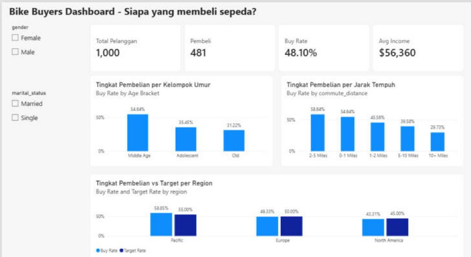

# Bike Buyers Dashboard di Power BI

Dashboard satu halaman yang menjawab pertanyaan **"siapa yang membeli sepeda?"** dari 1.000 data pelanggan. Ini versi Power BI dari dashboard Excel saya di Fase 1 (dataset dari [Alex The Analyst](https://github.com/AlexTheAnalyst/Excel-Tutorial)). Semua angkanya sudah saya cocokkan dengan versi Excel.

**Tools:** Power BI Desktop

**Teknik:** relationship (1 → *) · measure DAX (`COUNTROWS`, `CALCULATE`, `DIVIDE`, `ISBLANK`) · calculated column · slicer · format angka per measure



---

## Dataset
| File | Isi | Baris |
|---|---|---|
| `data/bike_customers.csv` | Data pelanggan: gender, status menikah, income, umur, jarak tempuh, region, dan status beli sepeda | 1.000 |
| `data/bike_regions.csv` | Region, sales manager, dan target persentase pembelian | 4 |

Model data: `bike_regions[region]` **1 → *** `bike_customers[region]`. Region Asia tidak punya pelanggan.

## Measure & kolom DAX
```DAX
Total Pelanggan = COUNTROWS(bike_customers)
Pembeli         = CALCULATE([Total Pelanggan], bike_customers[purchased_bike] = "Yes")
Buy Rate        = DIVIDE([Pembeli], [Total Pelanggan])
Avg Income      = AVERAGE(bike_customers[income])
Target Rate     = IF(ISBLANK([Buy Rate]), BLANK(), MAX(bike_regions[target_pct]) / 100)

-- calculated column
Age Bracket = IF(bike_customers[age] > 54, "Old",
              IF(bike_customers[age] >= 31, "Middle Age", "Adolescent"))
```
`DIVIDE` dan `ISBLANK` dipakai supaya Asia (0 pelanggan) tidak menghasilkan error atau tampil sebagai −40%.

## Isi dashboard
| Visual | Hasil (seluruh data) |
|---|---|
| KPI | 1.000 pelanggan · 481 pembeli · tingkat pembelian 48,1% · rata-rata income $56.360 |
| Tingkat pembelian per kelompok umur | Middle Age 54,6% · Adolescent 35,5% · Old 31,2% |
| Tingkat pembelian per jarak tempuh | 2-5 mil 58,6% · 0-1 mil 54,6% · 1-2 mil 45,6% · 5-10 mil 39,6% · 10+ mil 29,7% |
| Tingkat pembelian vs target per region | Pacific 58,9% (target 55%) · Europe 49,3% (target 50%) · North America 43,3% (target 45%) |
| Slicer | gender, marital_status. Contoh: Female menghasilkan 489 pelanggan, 239 pembeli, 48,9% |

## Temuan utama
1. **Usia 31–54 (Middle Age) adalah pasar utama.** Tingkat pembeliannya 54,6%, sedangkan dua kelompok lain hanya 31–35%.
2. **Jarak tempuh pendek paling potensial.** Pelanggan dengan jarak ≤ 5 mil membeli 46–59%, sedangkan yang > 10 mil hanya 30%.
3. **Hanya Pacific yang melampaui target.** Europe kurang 0,7 poin dan North America kurang 1,7 poin dari target.

**Rekomendasi:** fokuskan kampanye pada pelanggan usia 31–54 tahun yang jarak tempuhnya ≤ 5 mil, terutama di North America yang masih paling jauh di bawah target.

## Cara membuka
Unduh `Bike-Buyers-Dashboard.pbix`, lalu buka dengan Power BI Desktop (gratis di Microsoft Store). Kalau data perlu dimuat ulang, arahkan sumbernya ke folder `data/`.
